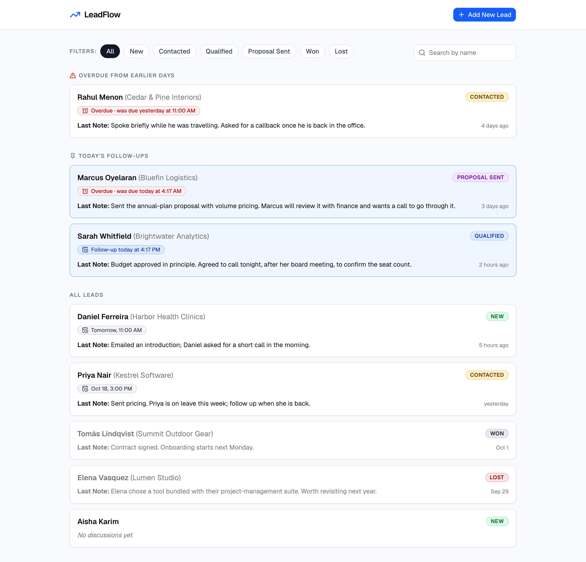
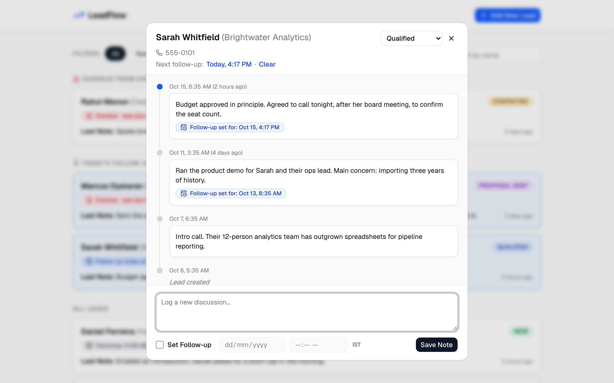
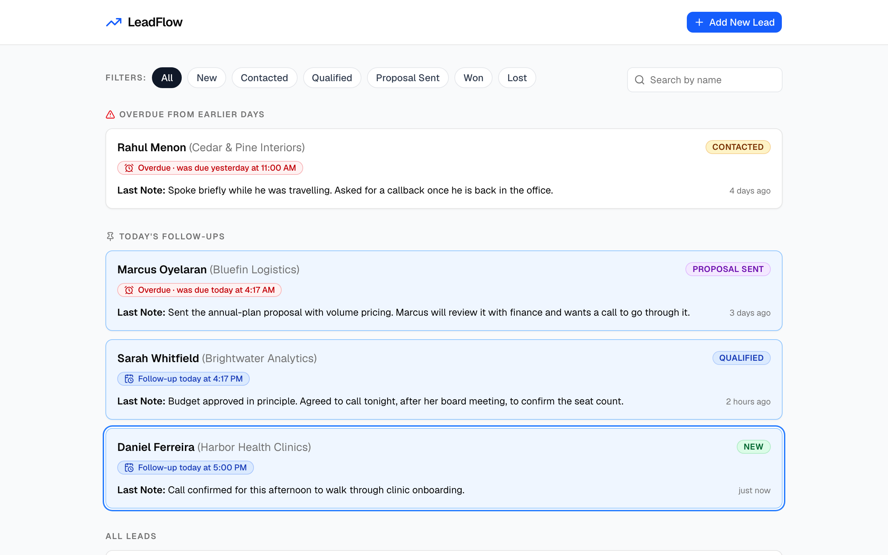

# LeadFlow

LeadFlow is a single-screen CRM for one sales rep: list leads, log discussions,
schedule follow-ups and update status from one dashboard, using dialogs instead
of separate pages.

> [!WARNING]
> LeadFlow has **no authentication**. Anyone who can reach port 8000 can read
> and modify every lead, including names and phone numbers. Run it only on your
> own machine (the Compose stacks bind their published ports to `127.0.0.1`) and
> **never expose it to the internet**. A real deployment would need
> authentication, per-user ownership of leads, HTTPS, rate limiting and a
> reviewed CORS policy.

## Contents

- [Demo video](#demo-video)
- [Screenshots](#screenshots)
- [Quick start](#quick-start)
- [Features](#features)
- [Technology stack](#technology-stack)
- [Architecture](#architecture)
- [Repository structure](#repository-structure)
- [Prerequisites](#prerequisites)
- [Configuration](#configuration)
- [Docker Compose stacks](#docker-compose-stacks)
- [Running on the host](#running-on-the-host)
- [Database migrations](#database-migrations)
- [Demo data](#demo-data)
- [Testing](#testing)
- [API overview](#api-overview)
- [Design decisions](#design-decisions)
- [Troubleshooting](#troubleshooting)
- [Security and data safety](#security-and-data-safety)
- [Known limitations](#known-limitations)
- [Use of AI](#use-of-ai)

## Demo video

[Watch the 2:38 demo on YouTube](https://youtu.be/v1z5Kz3HN3U)

A real recording of the application, made on the isolated end-to-end stack with
its synthetic demo data. It covers:

- the lead dashboard, search and status filtering;
- a lead's discussion timeline, and saving a new discussion;
- scheduling a follow-up, and seeing the lead appear in the correct dashboard
  group;
- a status change that persists after the page is reloaded;
- a brief technical overview.

## Screenshots



*Dashboard: overdue follow-ups in red and labelled "Overdue", today's
follow-ups pinned, all six status badges, and each lead's last note with how
long ago it was written.*



*Timeline dialog: lead details, the status select, the next follow-up with
Clear, notes newest first with the follow-up each one scheduled, and the
"Lead created" entry at the bottom.*



*After a note with a follow-up later today is saved, the lead moves into
Today's follow-ups straight away.*

More screenshots in [`docs/screenshots/`](docs/screenshots/): filtering and
search, Add Lead validation, a new lead, the follow-up form, a status change
surviving a reload, and the mobile layout. They were captured from the isolated
end-to-end stack with its demo data.

## Quick start

With Docker running:

```bash
cp .env.example .env
docker compose up --build
```

Then open <http://localhost:3000>. On first start the backend applies the
database migrations and inserts eight fictional demo leads. The API is at
<http://localhost:8000> (interactive docs at <http://localhost:8000/docs>).

If a PostgreSQL already runs on your machine on port 5432, the database
container cannot start. Add `POSTGRES_PROD_HOST_PORT=5434` (or any free port)
to `.env` first; see [Production stack](#production-stack).

Stop the stack with `docker compose down`. That keeps its data; never add `-v`
unless you mean to delete it.

## Features

- **Leads:** create a lead (name required; company and phone optional). New leads
  start as **New** and appear without a reload.
- **Dashboard in three groups:** *Overdue from earlier days*, *Today's
  follow-ups* (pinned) and *All leads*. Each card shows the status badge, the
  last note and how long ago it was written.
- **Six statuses** (New, Contacted, Qualified, Proposal Sent, Won, Lost) with
  distinct badge colours. You can filter by status, and combine that with a
  case-insensitive name search (debounced).
- **Timeline dialog:** lead details, the status select, the next follow-up with
  **Clear**, and the full discussion history, newest first. Each note shows the
  follow-up it scheduled.
- **Log a discussion** with an optional follow-up date and time, entered in the
  app timezone (shown as "IST"). The note and the follow-up are saved in one
  transaction. A note without a follow-up never changes the lead's existing one.
- **Overdue** follow-ups are red **and** say "Overdue", never colour alone.
- **Freshness:** the dashboard refetches every 60 seconds while visible, on
  window focus, and after every change.
- Accessible dialogs (focus trap, Esc, focus restore), keyboard navigation, field
  errors under the matching input, and loading, empty and error states with
  Retry. On narrow screens the timeline dialog fills the screen.

## Technology stack

| Area | Technology |
| ---- | ---------- |
| Frontend | Next.js 16 (App Router, client-rendered), React 19, TypeScript, Tailwind CSS 4, shadcn/ui on Base UI, date-fns and date-fns-tz |
| Backend | Python 3.12, FastAPI, Pydantic v2, pydantic-settings, Uvicorn |
| Database | PostgreSQL 17, SQLAlchemy 2.0 (synchronous), psycopg 3, Alembic |
| Testing | pytest (backend), Playwright (end-to-end) |
| Tooling | uv, Ruff, ESLint, Docker Compose |

## Architecture

```
Browser ──► Next.js client app (port 3000)
   │
   └──────► FastAPI /api/* (port 8000) ──► PostgreSQL
```

- The **browser calls FastAPI directly** at `NEXT_PUBLIC_API_URL`. Next.js serves
  the UI only: no API routes, no server-side data fetching, no proxy.
- FastAPI is split into routers (HTTP), services (business rules and
  transactions, one commit per write) and a pure follow-up module
  (`app/followups.py`) that classifies follow-ups and orders the dashboard.
- The backend alone decides whether a follow-up is due today or overdue, using
  `APP_TIMEZONE` and an injectable clock. The frontend only formats.
- Every change waits for the server and then refetches. There are no optimistic
  updates.

## Repository structure

```
.
├── backend/
│   ├── app/                  FastAPI app: config, db, models, schemas, errors,
│   │                         followups, services/, routers/
│   ├── alembic/              migration environment and versions/
│   ├── scripts/seed.py       demo data (insert-only, or a guarded reset)
│   ├── tests/                pytest suite
│   ├── docker-entrypoint.sh  production start-up: migrate, seed if empty, serve
│   ├── Dockerfile            production image
│   └── Dockerfile.dev        development image
├── frontend/
│   ├── app/, components/, lib/   Next.js app
│   ├── e2e/                  Playwright specs and global setup
│   ├── playwright.config.ts
│   ├── Dockerfile            production image (standalone server)
│   └── Dockerfile.dev        development image (next dev)
├── docker/postgres/          creates leadflow_test when a database volume is new
├── docker-compose.yml        production-style stack
├── docker-compose.dev.yml    development stack
├── docker-compose.e2e.yml    override for the isolated end-to-end stack
└── .env.example              configuration template
```

## Prerequisites

- **Docker** with Compose v2 (Docker Desktop, or Colima on macOS). Neither
  BuildKit nor buildx is required.
  - **With Colima's default configuration, keep the repository inside your home
    directory.** By default Colima may share only your home directory with its
    Docker VM. For a checkout elsewhere, bind mounts can appear empty inside the
    containers:
    - `docker/postgres/01-create-test-database.sql` is not loaded, so
      `leadflow_test` is not created;
    - the development stack's source mounts do not work either.

    Colima setups that share that directory through custom mounts are not
    affected.
- To run or test outside Docker:
  - **Node.js 20.9+** (developed with Node 24) and npm
  - **Python 3.12**
  - **[uv](https://docs.astral.sh/uv/getting-started/installation/)**

## Configuration

All configuration comes from one file at the repository root. Create it from the
template; it is git-ignored, so never commit it.

```bash
cp .env.example .env
```

The template's values are local-development placeholders. Change the database
password if you like, but keep `DATABASE_URL` and `TEST_DATABASE_URL` in step
with the `POSTGRES_*` values.

| Variable | Used by | Notes |
| -------- | ------- | ----- |
| `POSTGRES_USER`, `POSTGRES_PASSWORD`, `POSTGRES_DB` | Every Compose stack | The containerised backend builds its own `DATABASE_URL` for `db:5432` from these. |
| `DATABASE_URL` | Backend and Alembic **on the host** | Must use `postgresql+psycopg://`; validated at start-up. |
| `TEST_DATABASE_URL` | Backend database tests only | The name must end in `_test`. The template points it at `leadflow_test` on the **development** server, and the tests wipe their target, so export a disposable target instead; see [Backend](#backend). |
| `APP_TIMEZONE` | Backend; also the frontend's display timezone in Compose | Exact IANA name, default `Asia/Kolkata`. |
| `CORS_ORIGINS` | Backend | Comma-separated; at least one; `*` is rejected. Default `http://localhost:3000`. |
| `SEED_DEMO_DATA` | `python -m scripts.seed --auto` | Default `false`. The production Compose stack sets it to `true` itself. |
| `NEXT_PUBLIC_API_URL` | Frontend | The URL the **browser** uses for the API: `http://localhost:8000`. |
| `NEXT_PUBLIC_APP_TIMEZONE` | Frontend run on the host | Set it in `frontend/.env.local` to match `APP_TIMEZONE`; Compose passes `APP_TIMEZONE` instead. |
| `POSTGRES_PROD_HOST_PORT` | `docker-compose.yml` | Optional. Host port of the production database, default `5432`. |
| `POSTGRES_HOST_PORT` | `docker-compose.dev.yml` | Optional. Host port of the development database, default `5433`. |
| `E2E_BASE_URL`, `E2E_API_URL` | Playwright | Optional. Defaults `http://localhost:3001` and `http://localhost:8001`. |

**Precedence.** Variables exported in your shell override `.env`, both for a
backend run on the host and for Compose's `${VAR}` placeholders. If a value
seems wrong, `env | cut -d= -f1 | grep -E 'DATABASE_URL|APP_TIMEZONE|CORS_ORIGINS'`
lists exported names without printing values. Note that `docker compose config`
prints the resolved values, including the database password.

**Timezone.** `APP_TIMEZONE` defines "today". The backend refuses to start with
an unknown name. The frontend shows every date and time in that timezone, never
the browser's. `NEXT_PUBLIC_*` values are baked into the browser bundle when
the frontend is built, so changing them means rebuilding it.

## Docker Compose stacks

Three Compose projects, each with its own database, so none sees another's data:

| | Production | Development | End-to-end |
| - | ---------- | ----------- | ---------- |
| Files | `docker-compose.yml` | `docker-compose.dev.yml` | `docker-compose.yml` + `docker-compose.e2e.yml` |
| Project | `leadflow-prod` | `leadflow` | `leadflow-e2e` |
| Database storage | volume `leadflow-prod_postgres_data` | volume `leadflow_postgres_data` | in memory (`tmpfs`): empty on every start, nothing kept |
| Database host port | `127.0.0.1:5432` (`POSTGRES_PROD_HOST_PORT`) | `127.0.0.1:5433` (`POSTGRES_HOST_PORT`) | not published |
| Frontend, API | `3000`, `8000` | `3000`, `8000` | `3001`, `8001` |
| Images | built: `next build` standalone server, slim Python | `next dev` and Uvicorn `--reload`, source mounted | the production images, built with E2E settings |
| Migrations and demo data | applied at start-up | run from the host | applied at start-up |

The production and development stacks share ports 3000 and 8000, so **run only
one of them at a time**. The end-to-end stack can run next to either. Every
published port is bound to `127.0.0.1`.

### Production stack

```bash
docker compose up --build        # start
docker compose down              # stop; keeps the data
```

- **Start order.** PostgreSQL starts first. The backend waits for its health
  check (`pg_isready`), and the frontend waits for the backend's
  (`GET /api/health`).
- **Backend start-up** (`backend/docker-entrypoint.sh`):
  1. `alembic upgrade head` (nothing to do when already current);
  2. `python -m scripts.seed --auto`, with `SEED_DEMO_DATA=true`, inserts the
     demo data only into an **empty** database (in practice, the first start).
     It never resets or changes existing rows;
  3. Uvicorn.
  If any step fails, the container stops instead of serving an unmigrated API.
- **Frontend.** A `next build` standalone server. `NEXT_PUBLIC_API_URL` and the
  timezone are build arguments, so after changing them run
  `docker compose up --build`.
- **Images.** Multi-stage. Both containers run as non-root users (`app` and
  `node`). Neither image contains `.env` files or tests.
- **Database port.** Published on `127.0.0.1:5432` by default, matching the
  specification. If that port is taken, for example by a PostgreSQL installed on
  your machine, leave that service alone and add a different port to `.env`:

  ```bash
  POSTGRES_PROD_HOST_PORT=5434
  ```

  Only the host side changes. The backend still connects to `db:5432` inside
  the Compose network.

### Development stack

```bash
docker compose -f docker-compose.dev.yml up --build
docker compose -f docker-compose.dev.yml down
```

The frontend runs `next dev` and the backend runs Uvicorn with `--reload`, with
the source directories mounted for live changes. This stack does **not** apply
migrations or insert demo data: run them from the host (see
[Database migrations](#database-migrations) and [Demo data](#demo-data)).

Always pass `-f docker-compose.dev.yml` for this stack. Without it, `docker
compose` commands act on the production stack.

## Running on the host

Run PostgreSQL in Docker and the apps directly:

```bash
docker compose -f docker-compose.dev.yml up -d db
```

Backend (in `backend/`; it reads the root `.env`):

```bash
cd backend
uv sync --locked
uv run alembic upgrade head
uv run uvicorn app.main:app --reload --port 8000
```

Frontend (in `frontend/`, in a second terminal):

```bash
cd frontend
npm ci
npm run dev
```

Next.js does not read the root `.env`. `npm run dev` falls back to
`http://localhost:8000` for the API; to change it, or the display timezone, set
`NEXT_PUBLIC_API_URL` and `NEXT_PUBLIC_APP_TIMEZONE` in `frontend/.env.local`.
A production build (`npm run build`) has no fallback for the API URL. Never put
secrets in any `NEXT_PUBLIC_*` variable: they are public by design.

`npm run dev` listens on all network interfaces by default, whereas Uvicorn
started as above listens on `127.0.0.1` (its default).

## Database migrations

Alembic manages the schema (one migration, `0001`: the `leads` and
`discussions` tables with their CHECK constraints and index). The production
stack applies migrations itself. For the development database, run them from
`backend/`. They use `DATABASE_URL`, which in `.env.example` points to
`leadflow` on `localhost:5433`.

```bash
cd backend
uv run alembic upgrade head      # apply
uv run alembic current           # inspect, read-only
uv run alembic check             # do the models and the schema match?
```

> [!CAUTION]
> `uv run alembic downgrade base` drops both tables and **all their data**.
> Check which database `DATABASE_URL` points to before running it.

## Demo data

`backend/scripts/seed.py` inserts eight fictional leads (fake `555-01xx` phone
numbers) covering all six statuses and every follow-up state:

- later today, and earlier today (already overdue)
- overdue from yesterday
- tomorrow, and in three days
- none, including one lead with no discussions at all

Times are relative to the moment of seeding, in `APP_TIMEZONE`. Within ten
minutes of midnight, "later today" and "earlier today" move to the next or
previous day, so they never fall on the wrong side of midnight.

| Command (from `backend/`) | Effect |
| ------------------------- | ------ |
| `uv run python -m scripts.seed` | Inserts the demo data **only if `leads` and `discussions` are both empty**; otherwise changes nothing. |
| `uv run python -m scripts.seed --auto` | The same, but only when `SEED_DEMO_DATA=true`. Used at container start-up. |
| `uv run python -m scripts.seed --reset --yes --confirm-database NAME` | **Deletes every lead and discussion**, then inserts the demo data. |

Every mode checks that the database is migrated to the latest revision before
writing, and prints its target as `host:port/database`, never credentials.
Normal and `--auto` runs lock both tables, so two at once cannot both insert.

**Refreshing the demo after a day change.** Seeded times are relative to when
they were inserted, so on a later day "today" no longer matches. A reset
replaces them with fresh ones.

> [!CAUTION]
> **Never reset a database holding data you want to keep.** `--reset` deletes
> every lead and discussion in one transaction (rolled back entirely if
> anything fails). It runs only when **all** of these hold:
>
> - `--yes` is given;
> - `--confirm-database` names the target database exactly;
> - `DATABASE_URL` is exported in the environment (a value only in `.env` is
>   refused) and matches the URL the settings resolve.
>
> Before running it, check which database `DATABASE_URL` points to.

Resetting the **production stack's** demo data, inside its backend container
(where `DATABASE_URL` is already set). Replace `<database>` with your
`POSTGRES_DB` value:

```bash
docker compose exec backend python -m scripts.seed --reset --yes --confirm-database <database>
```

From the host, export `DATABASE_URL` for the target database and use the same
flags.

## Testing

### Backend

From `backend/`:

```bash
uv run ruff check .
uv run ruff format --check .
uv run pytest                 # read the warning below first
```

- **Database-free tests:** the follow-up classification tests (fixed clocks,
  the midnight boundary, UTC/IST date differences), the schema and settings
  tests, and the seed script's plan tests. To run only the seed script's
  database-free tests:
  `uv run pytest tests/test_seed.py -k "not db"`.
- **Database tests:** the API, service, model and migration tests, plus the seed
  tests named `test_db_*`. They use only `TEST_DATABASE_URL`, never
  `DATABASE_URL`. The fixture refuses a database whose name does not end in
  `_test`. Without a reachable test database, these tests fail with an
  explanation; they are never skipped silently.

> [!CAUTION]
> **The database tests destroy the data in their target database.** Once per
> run, the fixture downgrades the schema to empty and upgrades it again. Before
> each test it truncates `leads` and `discussions`, and the migration tests
> also drop `alembic_version`.
>
> `TEST_DATABASE_URL` is read from your environment first, then from the root
> `.env`. The template (`.env.example`) points it at `leadflow_test` on the
> **development** PostgreSQL server (`localhost:5433`). So a plain
> `uv run pytest` with that default **wipes the development `leadflow_test`
> database.**
>
> - Before running database tests, **export `TEST_DATABASE_URL`** for a
>   dedicated, disposable test database. Do not rely on the `.env` fallback.
> - **Check the resolved target** before running pytest (see below).
> - **Never use a production database.** Do not use the shared development
>   `leadflow_test` if it holds data you need to keep.
> - **A different database name is not proof of isolation.** Prefer a separate,
>   disposable PostgreSQL instance with its own storage.

**One way to get an isolated test database** (the approach used for the
results under [Use of AI](#use-of-ai)): a throwaway PostgreSQL container whose
data lives in memory, on its own port.

```bash
docker run -d --name leadflow-pytest-db \
  -e POSTGRES_USER=pytest -e POSTGRES_PASSWORD='<choose-a-password>' \
  -e POSTGRES_DB=leadflow_pytest_test \
  --tmpfs /var/lib/postgresql/data -p 127.0.0.1:5436:5432 postgres:17-alpine

cd backend
export TEST_DATABASE_URL='postgresql+psycopg://pytest:<choose-a-password>@127.0.0.1:5436/leadflow_pytest_test'
```

Replace the password placeholder, make sure port 5436 is free, and wait until
the server accepts connections. Then confirm what the tests will use before
running them:

```bash
uv run python -c 'import sys; sys.path[:0] = [".", "tests"]; import conftest; from sqlalchemy.engine import make_url; u = make_url(conftest.TestDatabaseSettings().test_database_url); print(u.host, u.port, u.database)'
uv run pytest
```

The check should print `127.0.0.1 5436 leadflow_pytest_test`. Stop the
container with `docker stop leadflow-pytest-db` when you are done; its data
disappears with it.

**`leadflow_test` in the Compose stacks.** Each Compose database volume gets an
empty `leadflow_test` database when it is first initialised
(`docker/postgres/01-create-test-database.sql`). It is a test target only for
disposable setups whose database holds nothing to preserve. On a volume created
before that script existed, you can add it once, without touching the other
databases:

```bash
docker compose -f docker-compose.dev.yml exec db createdb -U leadflow leadflow_test
```

### Frontend

From `frontend/`:

```bash
npm run lint
npm run typecheck
npm run build
```

### End-to-end (Playwright)

The specification's two required browser flows:

1. **Timeline follow-up** (`e2e/timeline-follow-up.spec.ts`): open a seeded lead
   → its timeline lists notes newest first, ending with "Lead created" → add a
   note with a follow-up later today → the note appears first with its follow-up
   → the lead moves from *All leads* into *Today's follow-ups*.
2. **Status persists** (`e2e/status-persists.spec.ts`): change a lead's status
   in the dialog → reload the page → the card and the dialog still show the new
   status.

They run against the isolated `leadflow-e2e` stack (in-memory database, ports
3001 and 8001), so they never touch the production or development data. They
need Docker with the `docker` CLI and Compose v2: the global setup runs
`docker compose` to find that stack and reset its demo data.

```bash
docker compose -f docker-compose.yml -f docker-compose.e2e.yml up -d --build
cd frontend
npm ci                              # installs the pinned @playwright/test (1.63.0)
npx playwright install chromium     # first run only: the browser for that version
npm run test:e2e
cd ..
docker compose -f docker-compose.yml -f docker-compose.e2e.yml down
```

Run `npm ci` before `npx playwright`. Otherwise, on a fresh clone, `npx` would
fetch whatever Playwright version is current instead of the pinned one.

- **Global setup.** Before the specs it refuses ports 3000 and 8000 and checks
  that `leadflow-e2e` serves the API on 8001. It then resets that stack's demo
  data with `scripts.seed --reset`, run inside the E2E backend container, as the
  specification requires a seed reset first.
- **Browser timezone.** The browser runs in `America/New_York`, which also checks
  that the app shows times in IST regardless of the browser's timezone.
- **Midnight.** The follow-up spec skips itself within ten minutes of midnight
  in IST, when no "later today" time is left. The backend's fixed-clock tests
  cover that boundary.
- Reports go to `frontend/playwright-report/` and `frontend/test-results/`
  (both git-ignored).

## API overview

Interactive documentation: <http://localhost:8000/docs>.

| Method | Path | Success | Purpose |
| ------ | ---- | ------- | ------- |
| `GET` | `/api/health` | `200 {"status":"ok","database":"ok"}` | Liveness and database check; `503` if PostgreSQL is unreachable |
| `GET` | `/api/leads?status=&q=` | `200` lead summaries | Dashboard list, already sorted into its groups. Both filters optional. |
| `POST` | `/api/leads` | `201` lead summary | Create a lead (`name`, optional `company`, `phone`) |
| `GET` | `/api/leads/{id}` | `200` lead with `discussions` | Timeline dialog: discussions newest first |
| `PATCH` | `/api/leads/{id}` | `200` lead summary | Change `status` and/or `next_follow_up_at`; `null` clears the follow-up |
| `POST` | `/api/leads/{id}/discussions` | `201` `{discussion, lead}` | Log a note, optionally with `follow_up_at` |

- **Requests.** Unknown fields are rejected. Timestamps must include a UTC offset
  (naive times are rejected) and a year from 2000 to 2100. Responses use UTC
  (`…Z`). Leave out `status` to list every status: an empty `status=` is a 422.
- **Errors.** Every non-2xx response has the same shape:

  ```json
  {"detail": "Validation failed", "code": "validation_error",
   "errors": [{"field": "name", "message": "Name is required"}]}
  ```

  | Status | `code` | When |
  | ------ | ------ | ---- |
  | 404 | `lead_not_found` | No lead with that id |
  | 404 | `not_found` | Unknown route |
  | 405 | `method_not_allowed` | Unsupported HTTP method |
  | 422 | `validation_error` | Invalid input; `errors` lists each field |
  | 500 | `internal_error` | Unexpected error; details are logged server-side only |
  | 503 | `database_unavailable` | No database connection: server down, wrong credentials or database name, or a dropped connection |

## Design decisions

- **Follow-up rules.** "Today" is the calendar day in `APP_TIMEZONE`
  (`Asia/Kolkata`, shown as IST). With `f` the lead's follow-up:
  - **Due today:** `start of today ≤ f < start of tomorrow` (a half-open interval);
  - **Overdue:** `f < now`, strictly.

  Both can be true. A 3 PM follow-up viewed at 5 PM stays under *Today* and
  turns red.
- **Dashboard order:**
  - *Overdue from earlier days*, oldest first (hidden when empty);
  - *Today's follow-ups* by time;
  - *All leads* by the latest discussion, then leads without discussions, newest
    first.

  Each lead appears exactly once.
- **Write rules:**
  - A note **with** a follow-up replaces the lead's current one; the old value
    stays visible on the earlier note.
  - A note **without** a follow-up never changes it.
  - A follow-up is cleared only by the explicit **Clear** action (`PATCH` with
    `null`).
  - Past times are accepted, with a warning in the form, so an overdue lead can
    be created from the UI.
- **Concurrent edits:** the last update the database applies wins. There is no
  version check.
- **One timezone** for all users, configured once (`APP_TIMEZONE`) and shared by
  both services.
- **Client-rendered Next.js** that calls FastAPI directly. There is no SEO need,
  and it avoids a second, server-side API URL.
- **Custom error envelope** instead of FastAPI's default shapes, so the frontend
  has one parser and can show field errors under inputs.
- The assignment's "FastAI" was read as **FastAPI**.

### Wireframes

The three supplied wireframes (LandingPage, AddLead and EditLead) are the visual
target. The UI follows them closely, with six documented deviations, needed to
meet the brief or to cover states the wireframes don't show (specification,
section 5):

| # | Wireframe | Implementation | Reason |
| - | --------- | -------------- | ------ |
| 1 | Filters show only All, New, Contacted, Qualified, Proposal Sent | Adds Won and Lost; the row wraps on narrow screens | The brief requires filtering by all six statuses |
| 2 | No search box | A compact search input on the right of the filter row | Bonus criterion |
| 3 | No overdue state | A red chip "Overdue · was due today at 2:00 PM"; a pinned "Overdue from earlier days" group above Today, with the same header style; a filter-aware empty message in Today | Bonus criterion; urgent items must be visible |
| 4 | The dialog header has no follow-up | A "Next follow-up: Today, 2:00 PM · Clear" line under the phone | Shows the state and gives Clear a home |
| 5 | A "Lead created via web form" entry | A synthetic italic "Lead created" entry built from `lead.created_at`; never counted as the last note | The lead source isn't tracked; avoids a fake discussion row |
| 6 | No loading, empty or error states | Skeleton cards, "No follow-ups today", inline error banners | The wireframes show only the happy path |

## Troubleshooting

| Symptom | Cause and fix |
| ------- | ------------- |
| The production `db` container cannot start because port 5432 is in use | Another PostgreSQL holds it. Set `POSTGRES_PROD_HOST_PORT=5434` (or another free port) in `.env`; do not stop the other service. |
| A stack cannot bind port 3000 or 8000 | The other stack (production or development) or a local server is running. Stop that one first; only one may use those ports. |
| The UI shows "Can't reach the server" | The backend is not running or not on `http://localhost:8000`. Check `docker compose ps` and `curl -i http://localhost:8000/api/health`. |
| API calls fail with CORS errors | Open the app at `http://localhost:3000` (not `127.0.0.1:3000`), or add that origin to `CORS_ORIGINS`. |
| `/api/health` returns 503 while PostgreSQL runs | The connection cannot be established: check `DATABASE_URL`, or the `POSTGRES_*` values for Compose. |
| A changed `NEXT_PUBLIC_*` value or timezone has no effect | They are baked in at build time. Rebuild with `docker compose up --build`. |
| Demo data shows yesterday's "today" | Seeded times are relative to when they were inserted. Reset the demo data ([Demo data](#demo-data)). |
| Backend tests fail with "TEST_DATABASE_URL is not set" or cannot connect | Export `TEST_DATABASE_URL` for a disposable test database and make sure it is running; see [Backend](#backend). Do not point it at production, or at a database holding data you need: the tests wipe their target. |
| `npm run test:e2e` stops with "Refusing to run…" | It is pointed at port 3000 or 8000. Start the `leadflow-e2e` stack and use the default URLs (3001/8001). |
| The seed script refuses with "run `alembic upgrade head` first" | That database is not migrated to the latest revision. Run `uv run alembic upgrade head` against it, then seed. |

## Security and data safety

- **No authentication** (see the warning above). Every published port is bound to
  `127.0.0.1`.
- **Secrets:**
  - `.env` is git-ignored and excluded from both Docker build contexts.
  - Neither image contains `.env` files, and the containers run as non-root users.
  - `.env.example` holds placeholders only.
  - `NEXT_PUBLIC_*` values are public by design.
- **Input and output:**
  - Every request field is validated: text by length (and the phone number by
    pattern), the status against the six values, timestamps by offset and
    year. Unknown fields are rejected. Database CHECK constraints are a second
    line of defence.
  - SQL is built only through SQLAlchemy, with no string-built queries.
  - React escapes all text, and notes are rendered as plain text.
  - 500 responses never include internals. Logs and seed output never print
    connection strings or passwords.
- **Data safety:**
  - The three Compose projects use separate databases.
  - Automatic seeding only ever inserts into an empty database.
  - A seed reset needs explicit confirmation of the target database.
  - The end-to-end tests run against an in-memory database and refuse the other
    stacks' ports.
  - `docker compose down -v` **deletes that stack's database volume**: it is
    `leadflow-prod_postgres_data` by default, or `leadflow_postgres_data` with
    `-f docker-compose.dev.yml`. Use it only when you mean to.

## Known limitations

- **Single user, no authentication;** not safe to expose beyond localhost.
- **Staleness:** follow-up state can be up to 60 seconds stale while the page is
  open, and the timeline dialog's header refreshes only after a change or when
  the dialog is reopened.
- **One business timezone** for all users; a multi-timezone team would need
  per-user settings.
- **Concurrent edits:** from two tabs, the last write wins, so one tab can
  silently overwrite the other's status or follow-up.
- **One follow-up per lead:** no task list, reminders or notifications.
- **No pagination:** the app is designed for tens to low hundreds of leads, and
  each lead's full history is returned at once.
- **Status changes are not recorded** in the timeline.
- **Whitespace:** the database's "not blank" checks reject values made only of
  ASCII whitespace. The API trims all whitespace, Unicode included, before
  saving.
- **Database error logs:** they can include PostgreSQL's row details, such as
  lead data, when a constraint fails. Query parameters are hidden.
- **`npm audit`:** reports 9 high-severity findings from one advisory,
  [GHSA-vfj7-8cjw-p6xm](https://github.com/advisories/GHSA-vfj7-8cjw-p6xm)
  (`braces` ≤ 3.0.3, through `eslint-config-next` and the `shadcn` CLI).
  - They are development tooling only: `npm audit --omit=dev` reports 0.
  - No compatible patched release exists yet.

## Use of AI

LeadFlow was built with **Claude Code**, an AI coding agent, under the
developer's direction. The work followed the written specification in small
stages, from the database schema to Docker and end-to-end tests. Each stage had a
read-only plan, an approved scope, the implementation, checks, and a review of
the diff before the commit.

**What was generated with AI**

- **Application code:** the backend (models, the Alembic migration, schemas,
  services, routers, error handling and follow-up classification) and the
  frontend (API client, time helpers, dashboard and both dialogs).
- **Supporting code:** the demo seed script, the Dockerfiles, the three Compose
  files and the container start-up script.
- **Tests:** the backend pytest suite and the Playwright specs.
- **Documentation:** this README.
- **Screenshots:** the nine images in `docs/screenshots/` show the real
  application. They were captured from the isolated end-to-end stack by a
  Playwright script written with AI assistance.
- **Demo video:** the footage is a recording of the running application on the
  isolated end-to-end stack, with its real interactions and API responses. The
  Playwright script that drove and recorded it (including the visible pointer)
  was written with AI assistance. So were the captions and the edit, assembled
  with Hyperframes: highlights, zooms, held frames and the closing card.
- **Process documents:** the plans, reviews and test reports behind each stage.

**What the developer decided or approved**

- **Scope and approval:** the developer set the scope of each stage, chose
  between the options the AI proposed, and approved every change before it was
  committed.
- **Decisions on behaviour and setup.** The developer made or confirmed these
  (some were the AI's proposals, which the developer approved):
  - one `APP_TIMEZONE` for both services;
  - a note with a follow-up replaces the lead's current follow-up (the
    specification's rule, confirmed by the developer);
  - the development database on host port 5433;
  - separate Compose projects and volumes for production, development and
    end-to-end tests;
  - a configurable production database port;
  - demo seeding on for the production stack but off by default;
  - an extra `--confirm-database` check on seed resets;
  - running the end-to-end tests after a real seed reset, as the specification
    requires.
- **Problems found and fixed.** The AI found these in its own reviews and
  tests, and rewrote the code with the developer's approval:
  - **Keyboard focus** was lost when a control was disabled during a save, or
    when Clear was removed; it is now restored.
  - **The timeline dialog** could close while a save was still pending. A
    shared flag became a counter.
  - **Pinned cards** lost their blue border on hover.
  - **Seed tests** would have hung a reset by holding a database lock.
  - **The README's reset example** used the development database's name; it now
    uses a placeholder.
  - **A seed reset** now refuses if the confirmed and configured database URLs
    differ.
  - **The backend image** failed to build without BuildKit.

**How it was verified**

- **Static checks:** ESLint, the TypeScript check and a production build for the
  frontend at each stage, and Ruff for the backend.
- **Backend tests:** run against a throwaway PostgreSQL server, never a shared
  database.
  - The server ran on `127.0.0.1:5436`, with database `leadflow_pytest_test` and
    its data in tmpfs (in memory).
  - `TEST_DATABASE_URL` was exported for the test process only.
  - Before testing, the resolved URL was checked, and the server's identity was
    confirmed as that throwaway server, not the development or production one.
  - Results:
    - the 8 seed database tests (`pytest tests/test_seed.py -k "test_db_"`)
      passed;
    - the full suite passed: **460 tests**;
    - `ruff check .` passed, and `ruff format --check .` found 29 files already
      formatted.
  - The production and development databases' row counts were unchanged
    afterwards.
- **Browser checks** of the dashboard and both dialogs:
  - The dashboard and the timeline dialog were checked against the real backend
    and a test database.
  - The Add Lead dialog was first checked against a stand-in API, and later
    against PostgreSQL.
  - The timeline checks covered keyboard use, focus, the mobile layout, and
    errors with the backend stopped, followed by recovery.
- **The production Docker stack**, built and run:
  - migrations and one-time demo seeding;
  - health checks and the non-root containers;
  - no `.env` files or secrets in the images;
  - 39 API checks and a browser walkthrough.
- **Playwright specs 2 and 3** passed in two consecutive runs against the
  isolated end-to-end stack. Production data was checked unchanged afterwards.
- **Clean clone of commit `c6124d5`**, in a separate, empty Colima VM, cloned
  inside the home directory, following the README's two setup paths:
  - **Docker setup ([Quick start](#quick-start)):**
    - both production images were built from scratch;
    - migration `0001` was applied;
    - the demo data was seeded (8 leads and 18 discussions), and `leadflow_test`
      was created;
    - the health check, frontend assets, CORS, the non-root users and a browser
      walkthrough all passed.
  - **Host setup ([Running on the host](#running-on-the-host)):**
    - the development database ran in Docker;
    - `uv sync --locked` and `npm ci` installed the dependencies, and the
      migration was applied;
    - the backend and frontend started, the API was healthy, and the empty
      dashboard loaded without console errors.
  - The original environment was unchanged afterwards (containers, volumes and
    database row counts).
  - An earlier clean clone (commit `3523f3e`) was made outside the home
    directory. Under Colima's default mounts, its database initialisation bind
    mount was empty, so `leadflow_test` was not created (see
    [Prerequisites](#prerequisites)). The `c6124d5` run inside the home
    directory resolved this.
- **Development stack:** started on alternate host ports, since production was
  running, so the README's default ports were not used.
  - It reused the existing database container and volume.
  - The development databases' row counts were identical before and after.
- **Development stack from a fresh clone of commit `e977997`**, with all three
  services in Docker under their own Compose project and a new database volume:
  - the frontend and backend used their default ports, 3000 and 8000. The
    database host port was set to 5435 with `POSTGRES_HOST_PORT`, because the
    existing development database held 5433;
  - migration `0001` was applied from the host. The health check, a browser
    walkthrough (add a lead, notes with and without a follow-up, a status change
    surviving a reload, clearing a follow-up) and all 460 backend tests, run
    against that stack's own `leadflow_test`, passed;
  - the production frontend and backend were stopped to free ports 3000 and
    8000, then restarted. The production and development environments were
    restored with their data unchanged.
- **Data during these runs:** the production database stayed at 9 leads and 21
  discussions, no volumes were deleted or pruned, and the repository was not
  changed.
- **Reviews:** the diff was checked before each commit. From the Add Lead dialog
  stage onward, every commit also followed a separate read-only review.

**Not yet verified or still outstanding:**

- **The developer's personal review** of this AI-use disclosure.
