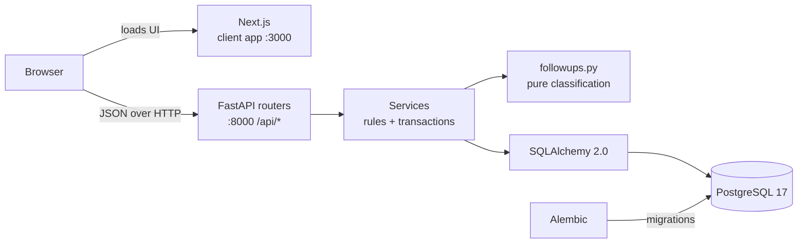
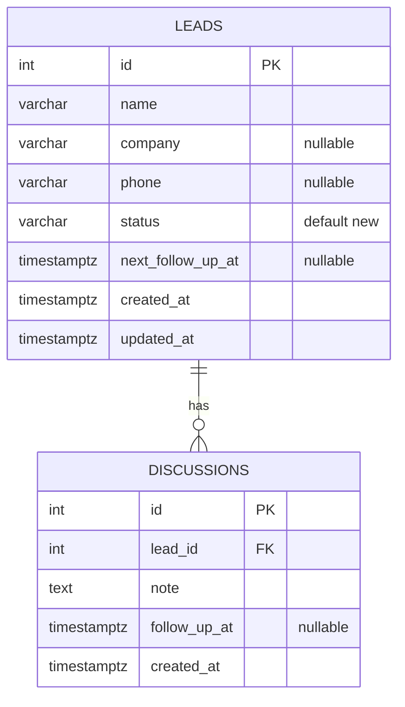

# LeadFlow — Software Requirements Specification

## 1. Document information

| Item | Value |
| ---- | ----- |
| Project | LeadFlow |
| Document | Software Requirements Specification (SRS) |
| Version | 1.0 |
| Date | 15 October 2026 |
| Status | Describes the implemented system at commit `64c202b` (`main`) |
| Source of truth | The code in this repository: `backend/app/`, `backend/alembic/`, `frontend/`, the tests and the Compose files |

**Purpose.** This document records what LeadFlow is required to do, how each
requirement is implemented, and how it is verified. It is written for an
existing product: every requirement's status was checked against the source
code and tests, not against the README alone. Setup and day-to-day use are
covered in the [README](../README.md).

## 2. Introduction

### 2.1 Purpose

To give reviewers and maintainers one place that states LeadFlow's functional
and non-functional requirements, the system's architecture, data model and
API, and the evidence that each requirement is met.

### 2.2 Scope

LeadFlow is a single-screen, single-user CRM for one sales representative. It
lists leads, records discussions with each lead, schedules one follow-up per
lead, and tracks the lead's status. It was built for the Pravar AI take-home
assignment.

In scope: the dashboard, the lead timeline dialog, the Add New Lead dialog, the
REST API, the PostgreSQL schema, demo seed data, Docker Compose stacks and the
automated tests.

Out of scope: authentication and multi-user access, deleting or editing a
lead's name, company or phone, reminders or notifications, pagination, and
deployment beyond a local machine.

### 2.3 Intended audience

- **Assessment reviewers** checking the assignment requirements (section 4,
  section 11).
- **Engineers** maintaining or extending the code (sections 6–10).

### 2.4 Definitions and abbreviations

| Term | Meaning |
| ---- | ------- |
| Lead | A sales prospect: a name, an optional company and phone, a status and at most one current follow-up. |
| Discussion | A note recorded against a lead, optionally scheduling a follow-up. |
| Follow-up | The next planned contact, stored as an instant (`next_follow_up_at`). |
| App timezone | `APP_TIMEZONE`, default `Asia/Kolkata`, shown in the UI as IST. "Today" is the calendar day in this timezone. |
| Due today | `start of today ≤ follow-up < start of tomorrow` in the app timezone (half-open interval). |
| Overdue | `follow-up < now` (strict). A follow-up can be both due today and overdue. |
| Brief | The Pravar AI assignment email. |
| Envelope | The API's single error body: `{"detail", "code", "errors"}`. |
| FR / NFR | Functional / non-functional requirement. |

## 3. Overall description

### 3.1 Product perspective

LeadFlow is a standalone web application with three parts: a client-rendered
Next.js frontend, a FastAPI backend and a PostgreSQL database. The browser
calls the API directly; Next.js serves the UI only. There are no external
service integrations.

### 3.2 Business problem

A sales representative has to remember each lead's stage, what was said last,
and when to call back. Keeping these in separate notes and reminders makes
follow-ups easy to miss. LeadFlow puts the lead list, the conversation history
and the next follow-up on one screen, and surfaces what is due today or
overdue.

### 3.3 Product objectives

1. Show every lead with its status, last note and how long ago it was written.
2. Make today's and overdue follow-ups impossible to miss.
3. Let the user log a conversation and schedule the next follow-up in one step.
4. Keep status and follow-up changes persistent and immediately visible.

### 3.4 Users and their needs

| User | Needs |
| ---- | ----- |
| Sales representative (single user) | See priorities at a glance; record a call quickly; find a lead by name or status; trust that changes are saved. |
| Reviewer / maintainer | Run the app locally with one command; understand the code; run the tests safely. |

### 3.5 Operating environment

- A desktop or mobile browser on the same machine as the stack.
- Docker with Compose v2 (production, development and end-to-end stacks), or
  Python 3.12 with `uv` and Node.js for running the services on the host.
- PostgreSQL 17 (`postgres:17-alpine` in Compose).
- All published ports are bound to `127.0.0.1`.

### 3.6 Constraints, assumptions and dependencies

| Type | Item |
| ---- | ---- |
| Constraint | Preferred stack from the brief: Next.js + FastAPI ("FastAI" in the brief is read as FastAPI). |
| Constraint | One screen plus dialogs; no separate pages for leads. |
| Assumption | Single user; login is optional in the brief and not implemented. |
| Assumption | Tens to low hundreds of leads, so no pagination. |
| Assumption | One business timezone for all users (`APP_TIMEZONE`). |
| Assumption | On concurrent edits, the last write the database applies wins. |
| Dependency | Frontend: Next.js 16, React 19, TypeScript, Tailwind CSS 4, shadcn/ui on Base UI, date-fns(-tz). |
| Dependency | Backend: FastAPI, Pydantic v2, pydantic-settings, SQLAlchemy 2.0 (synchronous), psycopg 3, Alembic, Uvicorn. |

## 4. Functional requirements

**Source** shows where a requirement comes from: **Brief** (mandatory),
**Bonus** (the brief's bonus list), or **Design** (a project decision that
supports a brief requirement). **Status** was checked against the source code
and tests listed in section 11.

### 4.1 Lead list

**FR-001 — Display all leads.** *Source: Brief. Status: Implemented.*
- *Behaviour:* the dashboard loads every lead from `GET /api/leads` and shows
  each lead exactly once, as a card.
- *Acceptance:* the number of cards equals the number of leads returned by the
  API; a database with no leads shows "No leads yet."

**FR-002 — Lead card content.** *Source: Brief. Status: Implemented.*
- *Behaviour:* each card shows the name, the company in parentheses if present,
  the status badge, the follow-up chip if a follow-up is set, the latest
  discussion note on one truncated line, and the time since that note.
- *Acceptance:* the note shown is the newest discussion (ties broken by id);
  the elapsed time reads "just now", "N min ago", "N hours ago", "yesterday",
  "N days ago" (up to 7), then a date; a lead with no discussions shows
  "No discussions yet".

**FR-003 — Lead statuses.** *Source: Brief. Status: Implemented.*
- *Behaviour:* a lead has exactly one of six statuses: New, Contacted,
  Qualified, Proposal Sent, Won, Lost (stored as `new`, `contacted`,
  `qualified`, `proposal_sent`, `won`, `lost`). Each has a distinct badge
  colour and its text label.
- *Acceptance:* the API rejects any other value with 422; the database rejects
  it with a CHECK constraint.

### 4.2 Lead creation

**FR-004 — Create a lead.** *Source: Brief. Status: Implemented.*
- *Behaviour:* "Add New Lead" opens a dialog with Full Name (required), Company
  (optional) and Phone (optional). Saving calls `POST /api/leads`, closes the
  dialog and refreshes the list.
- *Acceptance:* a valid lead returns 201 and appears without a page reload;
  a blank or whitespace-only name shows "Name is required" under the field and
  is rejected by the API with 422; the name is trimmed; an empty company or
  phone is stored as null.

**FR-005 — Default status New.** *Source: Brief. Status: Implemented.*
- *Behaviour:* the create form has no status field; the database default is
  `new`.
- *Acceptance:* a created lead has status New; a create request that includes
  `status` is rejected with 422 (unknown fields are not allowed).

### 4.3 Timeline dialog and discussions

**FR-006 — Open a lead in a dialog.** *Source: Brief. Status: Implemented.*
- *Behaviour:* clicking a card opens a modal dialog on the same screen with the
  lead's name, company, phone, status select, next follow-up (with Clear) and
  discussion history. On narrow screens the dialog fills the screen.
- *Acceptance:* the URL does not change; Esc or the close button closes the
  dialog and returns focus to the card.

**FR-007 — Discussion history, newest first.** *Source: Brief. Status: Implemented.*
- *Behaviour:* `GET /api/leads/{id}` returns all discussions ordered by
  `created_at` descending, then `id` descending. The timeline lists them in that
  order and ends with a "Lead created" entry. A note that scheduled a follow-up
  shows "Follow-up set for: …".
- *Acceptance:* entries = discussions + 1; the first entry is the newest note.

**FR-008 — Add a discussion note.** *Source: Brief. Status: Implemented.*
- *Behaviour:* the form at the bottom of the dialog takes a note (required,
  trimmed, at most 5,000 characters) and calls
  `POST /api/leads/{id}/discussions`. The saved note is added to the top of the
  timeline and the dashboard refreshes.
- *Acceptance:* 201 with the discussion and the updated lead; a blank note is
  rejected with "Note is required"; a missing lead returns 404 and nothing is
  inserted.

**FR-009 — Schedule a follow-up with a discussion.** *Source: Brief. Status: Implemented.*
- *Behaviour:* "Set Follow-up" reveals date and time inputs, entered in the app
  timezone. Saving sends `follow_up_at` with the note. The discussion and the
  lead's new `next_follow_up_at` are written in one transaction. A past time is
  accepted, with a warning in the form.
- *Acceptance:* the response's lead has the new follow-up; the dashboard moves
  the lead to the matching group without a reload; if the write fails before
  commit, neither the note nor the follow-up is saved.

**FR-010 — A note without a follow-up keeps the existing one.** *Source: Design. Status: Implemented.*
- *Behaviour:* when `follow_up_at` is omitted or null, the lead row is not
  modified.
- *Acceptance:* the lead's `next_follow_up_at` is unchanged after the note is
  saved.

**FR-011 — Clear a follow-up.** *Source: Design. Status: Implemented.*
- *Behaviour:* "Clear" in the dialog header sends
  `PATCH /api/leads/{id}` with `"next_follow_up_at": null`.
- *Acceptance:* 200 with `next_follow_up_at: null`; the lead returns to
  All leads.

**FR-012 — Update a lead's status.** *Source: Brief. Status: Implemented.*
- *Behaviour:* the status select in the dialog sends `PATCH /api/leads/{id}`
  with the new status; the select is disabled while saving; the dashboard
  refreshes.
- *Acceptance:* 200 with the new status; the card shows it; the status is
  unchanged after a page reload.

### 4.4 Follow-up visibility

**FR-013 — Today's follow-ups pinned.** *Source: Brief. Status: Implemented.*
- *Behaviour:* leads whose follow-up is due today are shown in a
  "Today's follow-ups" section above All leads, ordered by follow-up time,
  with a light-blue card style. When empty it shows "No follow-ups today".
- *Acceptance:* the section contains exactly the leads the API flags
  `follow_up_due_today`; "today" is computed in `APP_TIMEZONE`, not the
  browser's or server's local timezone; a pinned lead is not repeated in
  All leads.

**FR-014 — Identify overdue follow-ups.** *Source: Bonus. Status: Implemented.*
- *Behaviour:* an overdue follow-up is shown as a red chip with the text
  "Overdue · was due …" (never colour alone). Leads overdue from earlier days
  are pinned in an "Overdue from earlier days" section, oldest first; the
  section is hidden when empty. A follow-up earlier today stays under Today and
  turns red.
- *Acceptance:* the red chips correspond exactly to the leads the API flags
  `follow_up_overdue`.

**FR-015 — Dashboard grouping and order.** *Source: Design. Status: Implemented.*
- *Behaviour:* the API returns leads in dashboard order: overdue from earlier
  days (oldest first), today (earliest first), then all other leads (latest
  discussion first, leads without discussions last). Remaining ties are
  resolved by creation time and id, so the order is deterministic.
- *Acceptance:* each lead appears in exactly one group.

### 4.5 Finding leads

**FR-016 — Filter by status.** *Source: Brief; Bonus ("filters"). Status: Implemented.*
- *Behaviour:* pills for All and each of the six statuses (`aria-pressed`) set
  `GET /api/leads?status=…`. The group structure is kept within the filter.
- *Acceptance:* each pill shows exactly the leads with that status.

**FR-017 — Search by name.** *Source: Bonus. Status: Implemented.*
- *Behaviour:* the search box sends `q` after a 300 ms pause in typing. Matching
  is case-insensitive and substring-based; `%` and `_` are treated literally;
  input is trimmed and limited to 100 characters. Search combines with the
  status filter.
- *Acceptance:* "rah" with Qualified returns only qualified leads whose name
  contains "rah" in any case; with no match, the list shows
  "No leads match these filters."

### 4.6 Supporting requirements

**FR-018 — Keep the dashboard current.** *Source: Design. Status: Implemented.*
- *Behaviour:* the list is refetched after every change, every 60 seconds while
  the tab is visible, and on window focus. A newer request cancels an older one
  still in flight.

**FR-019 — Demo seed data.** *Source: Bonus. Status: Implemented.*
- *Behaviour:* `python -m scripts.seed` inserts 8 fictional leads and their
  discussions, with times relative to now, covering all six statuses, a lead
  with no discussions, follow-ups overdue from earlier days, due today (earlier
  and later), tomorrow, and none. It inserts only into an empty database.
  `--reset` replaces all data and requires `--yes`, `--confirm-database NAME`
  and an explicitly set `DATABASE_URL`.
- *Acceptance:* at least five leads with discussions after seeding an empty
  database; existing rows are never changed without `--reset`.

**FR-020 — Health check.** *Source: Design. Status: Implemented.*
- *Behaviour:* `GET /api/health` returns `{"status": "ok", "database": "ok"}`
  when PostgreSQL answers, or 503 `database_unavailable` otherwise. Compose uses
  it as the backend's health check.

**FR-021 — Authentication.** *Source: Brief (optional). Status: Optional — not implemented.*
- The brief makes login optional. LeadFlow is a single-user tool for local use;
  the README states that it must not be exposed beyond the local machine.

## 5. Non-functional requirements

| ID | Category | Requirement | How it is met |
| -- | -------- | ----------- | ------------- |
| NFR-001 | Usability | All work happens on one screen; dialogs instead of pages. | One route (`app/page.tsx`); timeline and Add Lead are modal dialogs. |
| NFR-002 | Usability / accessibility | Dialogs are keyboard-accessible; state is not conveyed by colour alone. | Focus trap, Esc to close, focus restored to the trigger; status badges have text labels; overdue chips say "Overdue"; field errors are linked to their inputs. |
| NFR-003 | Usability | The layout works on narrow screens. | Responsive layout; the timeline dialog fills the screen below the `sm` breakpoint and keeps the note form pinned at the bottom. |
| NFR-004 | Reliability | Every error response uses one envelope and never exposes internals. | `app/errors.py`: `{"detail", "code", "errors"}` for 404, 405, 422, 500 and 503; 500 bodies carry no exception text; connection details are not logged. |
| NFR-005 | Reliability | The UI degrades visibly when the server or database is unavailable. | Error banners with Retry on the dashboard and in the dialog; the last good list stays on screen; distinct messages for network and database failures. |
| NFR-006 | Data integrity | A note and its follow-up are saved atomically. | One `commit()` per write in `app/services/leads.py`; a failure before commit persists nothing (tested). |
| NFR-007 | Data integrity | The database enforces the core rules independently of the API. | NOT NULL columns, status CHECK, "not blank" CHECKs on name and note, foreign key with `ON DELETE CASCADE`, identity primary keys. |
| NFR-008 | Data integrity | Instants are unambiguous. | `TIMESTAMP WITH TIME ZONE` columns; requests without a UTC offset are rejected; responses are serialised in UTC (`…Z`). |
| NFR-009 | Input validation | Every request field is validated; unknown fields are rejected. | Pydantic models with `extra="forbid"`: name ≤ 120, company ≤ 120, phone ≤ 30 with pattern `[0-9+()\-\s]`, note ≤ 5,000, follow-up year 2000–2100 (UTC), lead id 1–2,147,483,647, search ≤ 100. |
| NFR-010 | Performance | The list endpoint does not issue one query per lead. | The latest discussion is joined in a single `DISTINCT ON` query (tested); search requests are debounced. No numeric response-time target is specified. |
| NFR-011 | Security | The application is restricted to local use. | No authentication (by design, see FR-021); all Compose ports bound to `127.0.0.1`; CORS allowlist from `CORS_ORIGINS`, with wildcards rejected at start-up. |
| NFR-012 | Security / configuration | Secrets are not committed or baked into images. | `.env` is git-ignored and excluded from Docker build contexts; `.env.example` holds placeholders; containers run as non-root users; SQL is built only through SQLAlchemy. |
| NFR-013 | Maintainability | Clear separation of concerns. | Routers (HTTP only) → services (business rules, transactions) → pure follow-up module; typed frontend API client; ESLint, TypeScript and Ruff clean. |
| NFR-014 | Testability | Time-dependent behaviour is deterministic in tests. | Injectable clock (`app/clock.py`); pure functions in `app/followups.py`; fixed-clock tests at day boundaries. |
| NFR-015 | Testability / safety | Tests cannot touch real data by accident. | The test fixture refuses databases whose name does not end in `_test`; end-to-end tests refuse ports 3000 and 8000 and run against an in-memory database. |

## 6. System architecture

### 6.1 Components

| Layer | Technology | Responsibility |
| ----- | ---------- | -------------- |
| Frontend | Next.js 16 (App Router, client-rendered), React 19, TypeScript, Tailwind CSS 4 | Renders the dashboard and dialogs; calls the API with `fetch`; formats times in the app timezone. Holds no business rules for "today" or "overdue". |
| API | FastAPI, Pydantic v2 | Validates requests, maps errors to the envelope, exposes OpenAPI docs at `/docs`. |
| Services | `app/services/leads.py` | Business rules and one transaction per write. |
| Follow-up logic | `app/followups.py` | Pure classification (due today, overdue) and dashboard sort keys. |
| Persistence | SQLAlchemy 2.0, psycopg 3 | ORM models and queries. |
| Database | PostgreSQL 17 | Storage and integrity constraints. |
| Migrations | Alembic (revision `0001`) | Creates the schema. |
| Runtime | Docker Compose | Production (`leadflow-prod`), development (`leadflow`) and end-to-end (`leadflow-e2e`) stacks with separate databases. |

### 6.2 Request flow

1. The browser loads the client app from Next.js (port 3000).
2. Client components call FastAPI directly at `NEXT_PUBLIC_API_URL`
   (port 8000). Next.js has no API routes, server-side fetching or proxy.
3. A router validates the request and calls a service function.
4. The service reads or writes through SQLAlchemy in one session and computes
   the follow-up flags with `app/followups.py`.
5. The response returns to the browser, which re-renders. Writes are never
   applied optimistically: the UI waits for the server, then refetches.

### 6.3 Deployment (local)

In the production Compose stack the database starts first; the backend waits
for its health check, applies migrations (`alembic upgrade head`), seeds only
an empty database when `SEED_DEMO_DATA=true`, then starts Uvicorn; the frontend
waits for the backend's health check. Data is kept in the named volume
`leadflow-prod_postgres_data`.

## 7. Data requirements

### 7.1 Entities

**`leads`**

| Column | Type | Null | Rules |
| ------ | ---- | ---- | ----- |
| `id` | integer | no | Primary key, `GENERATED ALWAYS AS IDENTITY` |
| `name` | varchar(120) | no | CHECK: contains a non-whitespace character |
| `company` | varchar(120) | yes | — |
| `phone` | varchar(30) | yes | Pattern enforced by the API |
| `status` | varchar(20) | no | Default `new`; CHECK: one of the six status values |
| `next_follow_up_at` | timestamptz | yes | The lead's current follow-up |
| `created_at` | timestamptz | no | Default `now()` |
| `updated_at` | timestamptz | no | Default `now()`; set on every update |

**`discussions`**

| Column | Type | Null | Rules |
| ------ | ---- | ---- | ----- |
| `id` | integer | no | Primary key, `GENERATED ALWAYS AS IDENTITY` |
| `lead_id` | integer | no | Foreign key → `leads.id`, `ON DELETE CASCADE` |
| `note` | text | no | CHECK: contains a non-whitespace character |
| `follow_up_at` | timestamptz | yes | The follow-up this note scheduled (kept as history) |
| `created_at` | timestamptz | no | Default `now()` |

Index `ix_discussions_lead_created` on (`lead_id`, `created_at DESC`, `id DESC`)
supports the newest-first history.

### 7.2 Relationship and rules

- One lead has zero or more discussions; each discussion belongs to exactly one
  lead.
- Deleting a lead deletes its discussions (database cascade). The API has no
  delete endpoint.
- A discussion's `follow_up_at` is independent of the lead's
  `next_follow_up_at`: a later follow-up replaces the lead's value but leaves
  earlier notes unchanged.
- `follow_up_due_today`, `follow_up_overdue` and `last_discussion` are not
  stored; the API computes them per request from the current time and
  `APP_TIMEZONE`.

## 8. API requirements

Base URL: `http://localhost:8000`. Interactive documentation: `/docs`.
Request and response bodies are JSON. Timestamps in responses are UTC.

| Method | Route | Purpose | Request | Success | Errors |
| ------ | ----- | ------- | ------- | ------- | ------ |
| GET | `/api/health` | API and database health | — | 200 `{"status":"ok","database":"ok"}` | 503 |
| GET | `/api/leads` | Leads in dashboard order | Query: `status` (one of six, optional), `q` (name search, ≤ 100, optional) | 200 `LeadSummary[]` | 422 |
| POST | `/api/leads` | Create a lead | `{"name", "company"?, "phone"?}` | 201 `LeadSummary` | 422 |
| GET | `/api/leads/{id}` | Lead with full history | Path `id` (1–2,147,483,647) | 200 `LeadDetail` | 404, 422 |
| PATCH | `/api/leads/{id}` | Change status and/or follow-up | `{"status"?, "next_follow_up_at"?}`; at least one field; `null` follow-up clears it; `null` status is rejected | 200 `LeadSummary` | 404, 422 |
| POST | `/api/leads/{id}/discussions` | Add a note, optionally scheduling a follow-up | `{"note", "follow_up_at"?}` | 201 `{"discussion", "lead"}` | 404, 422 |

**`LeadSummary`:** `id`, `name`, `company`, `phone`, `status`,
`next_follow_up_at`, `follow_up_due_today`, `follow_up_overdue`,
`last_discussion` (`{note, created_at}` or null), `created_at`, `updated_at`.
**`LeadDetail`** adds `discussions` (each `id`, `note`, `follow_up_at`,
`created_at`), newest first.

**Error codes** (all in the envelope; `errors` lists field problems for 422):

| Status | `code` | When |
| ------ | ------ | ---- |
| 404 | `lead_not_found` | The lead id does not exist |
| 404 | `not_found` | Unknown route |
| 405 | `method_not_allowed` | Unsupported method on a known route |
| 422 | `validation_error` | Invalid body, path or query; unknown fields; timestamps without an offset |
| 500 | `internal_error` | Unexpected server error (no internals in the body) |
| 503 | `database_unavailable` | PostgreSQL cannot be reached |

## 9. User interface requirements

| Area | Requirement (as implemented) |
| ---- | ---------------------------- |
| Screen | One page: header with "Add New Lead", filters and search, then the lead groups. |
| Lead cards | Name and company, status badge, follow-up chip, last note (one line), elapsed time; Won and Lost cards are muted; the whole card opens the timeline. |
| Filters and search | "Filters:" All plus six status pills; "Search by name" box; both apply together. |
| Groups | "Overdue from earlier days" (only when non-empty), "Today's follow-ups" (pinned, light blue), "All leads", each with a count. |
| Follow-up chips | Red "Overdue · was due …"; blue "Follow-up today at …"; grey for later dates (for example "Tomorrow, 11:00 AM"). |
| Timeline dialog | Header: name, company, phone, status select, "Next follow-up" with Clear. Body: scrollable history, newest first, ending with "Lead created". Footer: note box, "Set Follow-up" with date and time inputs labelled IST, "Save Note". |
| Add New Lead dialog | Full Name (required), Company (optional), Phone (optional); Cancel and Save Lead. |
| Loading | Skeleton cards on the dashboard and in the dialog. |
| Empty | "No leads yet.", "No leads match these filters.", "No follow-ups today", "No discussions yet". |
| Validation | Messages under the matching field (for example "Name is required", "Note is required"); a warning when the chosen follow-up time is in the past. |
| Errors | Inline banners with Retry (for example "Can't reach the server."); dialogs stay open with the user's input after a failed save. |

## 10. Testing and verification

### 10.1 Test inventory

| Suite | Location | Cases | Needs a database | Covers |
| ----- | -------- | ----- | ---------------- | ------ |
| Follow-up unit tests | `backend/tests/test_followups.py` | 26 | No | Due-today and overdue rules, midnight boundaries, UTC/IST date differences, group ordering |
| Schema tests | `test_schemas.py` | 90 | No | Field limits, trimming, unknown fields, timezone and year rules |
| Error tests | `test_errors.py` | 30 | No | Error envelope, no leaked internals |
| Foundation tests | `test_foundation.py` | 21 | No | Configuration (timezone, CORS, database URL) and health check failure handling |
| Seed tests | `test_seed.py` | 138 | 8 of them | Demo plan, midnight-safe times, reset safeguards |
| Service tests | `test_lead_services.py` | 24 | Yes | Business rules, single-query listing, transactions |
| Leads API tests | `test_leads_api.py` | 44 | Yes | List, filter, search, create, get, patch, 404/405/422/500/503 |
| Discussions API tests | `test_discussions_api.py` | 31 | Yes | Notes with and without follow-ups, history, rollback |
| API integration tests | `test_api_integration.py` | 19 | Yes | Group movement after writes, CORS, OpenAPI, 503 on every endpoint |
| Model tests | `test_models.py` | 34 | Yes | Constraints, defaults, cascade, ordering |
| Migration tests | `test_migrations.py` | 3 | Yes | Upgrade/downgrade cycle, schema matches models |
| End-to-end | `frontend/e2e/*.spec.ts` (Playwright) | 2 | Isolated E2E stack | Note with a follow-up later today moves the lead into Today's follow-ups; a status change survives a reload |

The backend suite collects **460** cases. Frontend quality is checked with
ESLint and TypeScript (`tsc --noEmit`); there are no frontend unit tests.

### 10.2 Evidence

| Check | Status |
| ----- | ------ |
| Database-free backend tests (`test_followups`, `test_schemas`, `test_foundation`, `test_errors`, `test_seed -k "not db"`) | Executed while preparing this document (15 October 2026): 297 passed. |
| Ruff, ESLint, TypeScript | Executed while preparing this document (15 October 2026): all pass. |
| Full backend suite (460) | Previously executed on 15 October 2026 against isolated PostgreSQL databases: all passed. Not re-run for this document, because it needs a database server. |
| Playwright specs | Previously executed twice against the isolated `leadflow-e2e` stack: both passed. Not re-run for this document. |
| Manual and scripted checks | Previously executed: clean-clone runs of the Docker and host setups and a fresh-clone run of the development stack (recorded in the README under "Use of AI", "How it was verified"), and a scripted, read-only browser audit of the running application on 15 October 2026. |

The application code has not changed since commit `8384389`; later commits
change documentation and screenshots only, so the earlier results apply to the
current code.

## 11. Requirements traceability matrix

| ID | Summary | Implementation | Verification | Status |
| -- | ------- | -------------- | ------------ | ------ |
| FR-001 | Display all leads | `GET /api/leads`; `lead-dashboard.tsx` | `test_leads_api`; browser check | Implemented |
| FR-002 | Card: name, status, last note, elapsed time | `_summary_query`; `lead-card.tsx`; `lib/time.ts` | `test_leads_api`, `test_lead_services`; browser check | Implemented |
| FR-003 | Six statuses | `LeadStatus`; status CHECK; `status-badge.tsx` | `test_models`, `test_schemas` | Implemented |
| FR-004 | Create a lead | `POST /api/leads`; `add-lead-dialog.tsx` | `test_leads_api`, `test_schemas`; browser check | Implemented |
| FR-005 | Default status New | `server_default='new'`; `LeadCreate` | `test_models`, `test_leads_api` | Implemented |
| FR-006 | Timeline in a dialog | `lead-timeline-dialog.tsx` | Browser check | Implemented |
| FR-007 | History newest first | `Lead.discussions` order; `GET /api/leads/{id}` | `test_leads_api`, `test_models`; E2E spec 2 | Implemented |
| FR-008 | Add a note | `POST …/discussions`; `discussion-form.tsx` | `test_discussions_api`; E2E spec 2 | Implemented |
| FR-009 | Follow-up with a note, one transaction | `services.add_discussion` | `test_discussions_api`, `test_lead_services`; E2E spec 2 | Implemented |
| FR-010 | Note without follow-up keeps it | `services.add_discussion` | `test_discussions_api`, `test_lead_services` | Implemented |
| FR-011 | Clear a follow-up | `PATCH` with `null`; Clear button | `test_leads_api`, `test_lead_services` | Implemented |
| FR-012 | Update status, persisted | `PATCH /api/leads/{id}`; status select | `test_leads_api`; E2E spec 3 | Implemented |
| FR-013 | Today's follow-ups pinned | `followups.classify`; `lib/dashboard.ts` | `test_followups`, `test_api_integration`; E2E spec 2 | Implemented |
| FR-014 | Overdue in red, labelled | `follow-up-label.tsx`; overdue group | `test_followups`, `test_discussions_api`; browser check | Implemented |
| FR-015 | Grouping and order | `followups.dashboard_sort_key` | `test_followups`, `test_lead_services` | Implemented |
| FR-016 | Status filter | `?status=`; `lead-filters.tsx` | `test_leads_api`, `test_api_integration`; browser check | Implemented |
| FR-017 | Name search | `?q=` (`icontains`, `autoescape`) | `test_leads_api`, `test_lead_services`; browser check | Implemented |
| FR-018 | Dashboard freshness | `refreshLeads` (60 s, focus, after writes) | Code inspection | Implemented |
| FR-019 | Demo seed data | `scripts/seed.py` | `test_seed` | Implemented |
| FR-020 | Health check | `GET /api/health` | `test_foundation`, `test_api_integration` | Implemented |
| FR-021 | Authentication | — | — | Optional (not implemented) |

"Browser check" refers to the scripted, read-only browser audit of the running
application described in section 10.2.

## 12. Assumptions, limitations and future scope

**Current capabilities.** Everything in section 4 marked Implemented, plus
three isolated Compose stacks, demo data and the automated tests in section 10.

**Known limitations** (also listed in the README):
- Single user, no authentication; not safe to expose beyond the local machine.
- Follow-up state can be up to 60 seconds stale while the page is open; the
  dialog header refreshes after a change or when reopened.
- One business timezone for all users.
- Concurrent edits from two tabs: the last write wins, with no conflict check.
- One follow-up per lead; no reminders or notifications.
- No pagination; each lead's full history is returned at once.
- Status changes are not recorded in the timeline.
- Lead name, company and phone cannot be edited, and leads cannot be deleted,
  through the API or UI (not required by the brief).

**Optional features not implemented:** authentication (optional in the brief);
the specification's optional Playwright specs for lead creation, filtering and
overdue display; continuous integration.

**Possible future enhancements:** authentication and per-user ownership of
leads; editing and deleting leads; a status-change history; reminders;
pagination or virtual scrolling for large lists; optimistic-concurrency checks;
a CI pipeline running the tests on every push.

## 13. Acceptance criteria and conclusion

LeadFlow meets its intended purpose when:

1. The dashboard lists every lead with name, status badge, last note and elapsed
   time, and filters by all six statuses (FR-001–FR-003, FR-016).
2. Today's follow-ups are pinned and overdue follow-ups are red and labelled
   (FR-013–FR-015).
3. A lead opens in a dialog with its full history newest first, and a note with
   a follow-up updates the lead and the dashboard without a reload
   (FR-006–FR-010).
4. Status changes persist across reloads (FR-012).
5. A lead can be created with only a name and starts as New (FR-004, FR-005).
6. The API returns correct status codes in one error format (section 8).
7. The application runs locally with Docker Compose and seeded demo data
   (FR-019, section 6.3).

All mandatory requirements in section 4 are implemented and traced to code and
tests in section 11. LeadFlow is a local, single-user application; it is not
intended or hardened for production deployment.
